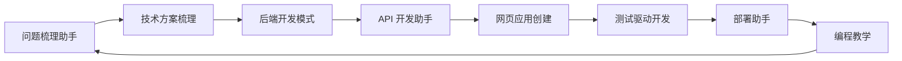

# 程序员工作流 MCP

一个 Python stdio MCP 服务。八个角色各做一件事：可以单独调用，也可以沿交接环把上一任产物交给下一位，绕回入口即结束。

仓库：https://github.com/PrimePeace/agent

服务不调用外部大模型，也不需要 API Key。每个角色按自己的方法论，把需求原文整理成可复现的交付物。Cursor 里的模型再按这些产物写业务代码。

每个角色的判断规则写在 `skills/<技能名>/SKILL.md`。改 Markdown 即可调整行为，下一次调用生效，不用改代码、不用重启。

## 在 Cursor 里怎么用

1. 安装依赖并保持虚拟环境：

```powershell
py -3.13 -m venv .venv
.\.venv\Scripts\python.exe -m pip install -e ".[dev]"
```

2. 在 Cursor 的 MCP 设置里启用 `programmer-workflow`。项目配置在 `.cursor/mcp.json`。要在任意项目里都能用，把同一段写进用户级 `~/.cursor/mcp.json`，并把路径改成你本机的绝对路径。
3. 重连服务。工具列表应出现 13 个工具（8 个角色 + `run_workflow` / `resume_workflow` / `get_workflow` / `list_agents` / `invoke_skill`）。
4. 新开一轮对话，把需求写清楚，并点名工具。

整环：

```text
使用 run_workflow。需求：用户可以创建订单并查询订单状态。需要登录。峰值 500 QPS，下单接口 P99 200 毫秒以内，订单数据强一致。仅后端，不要前端。
```

只做一个人：

```text
使用 problem_clarifier。需求：用户可以创建订单并查询订单状态。需要登录。峰值 500 QPS。仅后端。
```

新加的技能还没出现在工具列表里时：

```text
使用 invoke_skill。skillId 是 my_reviewer。需求：……
```

需求太短会停在 `WAITING_FOR_USER`。把返回的 `sessionId` 带上，再用 `resume_workflow` 补充。不要把密钥、口令或生产数据写进 demand。

## 为什么是一个服务里的八个工具

| 方案 | 复杂度 | 单独调用 | 交接 | 结论 |
| --- | --- | --- | --- | --- |
| 八个独立 MCP 进程 | 高，要自己做跨进程会话 | 自然 | 困难 | 不采用 |
| 一个服务只返回提示词，由宿主临场发挥 | 低 | 可以 | 每次结果不稳定，无法测试退回 | 不采用 |
| 一个服务，进程内执行角色并保存会话 | 中 | 同名工具 | 环、退回、暂停都在服务里 | 采用 |

选择第三种，是因为「整个技能组件就是一个 MCP 服务」和「每个技能也能单独调用」要同时成立，而且交接结果要能在没有模型密钥时复现。

## 交接环

界面上的八宫格是目录，不是执行顺序。交付顺序是：



`run_workflow` 从 `entryAgentId` 开始，默认是问题梳理助手。每一位把结构化产物写入会话，下一位读得到。绕回到入口就结束。

两种回退：

- 需求短到看不出目标和成功标准时，问题梳理助手把会话停在 `WAITING_FOR_USER`。用 `resume_workflow` 补充后继续。
- 清晰度不足 60 时，技术方案梳理退回问题梳理助手一次。测试角色发现写接口没有幂等约定时，退回 API 角色一次，并回到退回者复核。同一对角色只退回一次。

`scope=backend-only`，或原文里出现「仅后端 / 不要前端」时，网页角色跳过并写明原因。没有在启动时写死 `scope` 的会话，后面补充的范围说明仍然生效。

## 工具

| 工具 | 作用 |
| --- | --- |
| `list_agents` | 查看角色、职责、交接环和技能目录 |
| `problem_clarifier` | 只做问题梳理 |
| `solution_designer` | 只做方案对比 |
| `backend_architect` | 只做后端结构 |
| `api_developer` | 只做接口契约 |
| `web_app_builder` | 只做网页方案，仅后端时跳过 |
| `tdd_engineer` | 只做测试计划 |
| `deployment_engineer` | 只做发布与回滚 |
| `programming_mentor` | 只做讲解 |
| `run_workflow` | 从某一位开始跑完整环 |
| `resume_workflow` | 补充信息或提高步数后继续 |
| `get_workflow` | 读取会话 |
| `invoke_skill` | 按技能 id 调用，新增技能不用重连就能用 |

单独调用不会创建会话，也不会自动进入下一位。产物字段保持 camelCase，例如 `clarityScore`、`idempotentWrites`、`sessionId`。单独调用的返回里带 `knowledge` 和 `knowledgePath`；工作流返回里带 `skillKnowledge`，宿主实现代码时按这些知识库来。

## 技能知识库

每个技能是 `skills/` 下一个文件夹。`SKILL.md` 是知识库，`agent.py` 可选。进程每次调用都会重新读文件。

| 技能 | 知识库现在写了什么 |
| --- | --- |
| `problem_clarifier` | 四步判断需求能否执行；盲区问题表；不替用户猜范围的反例 |
| `solution_designer` | 单体 / 微服务选型信号表；一致性三种写法；禁止两阶段提交 |
| `backend_architect` | 模块职责；状态机与乐观锁；错误码表；安全底线 |
| `api_developer` | 标准端点表；幂等键先插后读；cursor 分页 |
| `web_app_builder` | 三页起步；页面只保留草稿和错误码；表单上的幂等键 |
| `tdd_engineer` | 五条必备用例；测试金字塔；幂等缺失时退回一次 |
| `deployment_engineer` | 五段流水线；蓝绿 / 滚动对照；库变更两步走；告警表 |
| `programming_mentor` | 三档讲解深度；练习必须覆盖失败路径、幂等和回滚 |

改 `SKILL.md` 后，下一次调用就会读到新内容。每份末尾留有「补充规则」，直接往里加条目。

新建文件夹就是新增技能：

- `ring: false`：只单独调用，不进原来的八步环。
- `ring: true`：按 `order` 插进交接环。内置角色的顺序是 10 到 80，中间可以插入，例如 35。
- 没有 `agent.py`：把 Markdown 交给 Cursor 里的模型，由它按文档处理。
- 有 `agent.py` 并定义 `execute(context)`：用脚本的返回值代替内置规则。

脚本约定和示例见 [skills/README.md](skills/README.md)。新增文件夹后立刻可以用 `invoke_skill`。要在工具列表里看到同名工具，重连一次 MCP。

## 运行

需要 Python 3.10 或更高版本。本仓库的虚拟环境用 3.13。

```powershell
py -3.13 -m venv .venv
.\.venv\Scripts\python.exe -m pip install -e ".[dev]"
$env:PYTHONIOENCODING = "utf-8"
$env:PROGRAMMER_SKILLS_DIR = "E:\ai-java\Agent\skills"
.\.venv\Scripts\python.exe -m programmer_workflow
```

标准输出只传输 MCP 帧。日志在标准错误。

| 环境变量 | 默认值 | 作用 |
| --- | --- | --- |
| `WORKFLOW_DATA_DIR` | `./data/workflows` | 会话 JSON 目录。已在 `.gitignore` 里 |
| `PROGRAMMER_SKILLS_DIR` | 仓库里的 `skills/` | 技能知识库目录 |
| `PYTHONIOENCODING` | 建议 `utf-8` | 避免 Windows 下中文协议帧乱码 |

Cursor 改完服务代码后需要重连 MCP。只改 `SKILL.md` 或 `agent.py` 不用重连。

调用 `run_workflow` 的参数示例：

```json
{
  "demand": "用户可以创建订单并查询状态。需要登录。峰值 500 QPS。仅后端。",
  "scope": "backend-only"
}
```

信息不够时返回 `WAITING_FOR_USER`，再用：

```json
{
  "sessionId": "上一步返回的 UUID",
  "feedback": "调用方是已登录用户，创建订单必须能安全重试"
}
```

## 错误码

| 码 | 类型 | 含义 |
| --- | --- | --- |
| AGENT-4001 | 业务 | 参数类型或取值不合法 |
| AGENT-4002 | 业务 | 没有这个角色 |
| AGENT-4004 | 业务 | 会话不存在 |
| AGENT-4091 | 业务 | 会话已结束，不能 resume |
| AGENT-4221 | 业务 | 需求为空、过长或含非法字符 |
| AGENT-4222 | 业务 | 会话步数达到 32 的绝对上限 |
| AGENT-5000 | 系统 | 角色执行失败 |
| AGENT-5002 | 系统 | 会话写入失败 |

业务错误以工具错误返回，消息文本以错误码开头，例如 `AGENT-4221 demand 不能为空`。系统错误只返回固定说明，堆栈留在标准错误，不回传给调用方。

## 测试

```powershell
.\.venv\Scripts\python.exe -m pytest
.\.venv\Scripts\python.exe scripts\smoke_mcp.py
```

覆盖完整环、从任意角色绕回、需求过短时等待、补充后继续、方案退回一次、仅后端跳过网页、高峰值推荐微服务、会话重启后仍能读取、工具层的业务错误，以及技能知识库：改 Markdown 下一次调用生效、新技能可插环、`agent.py` 热替换。冒烟脚本会握手、列出全部工具，并检查「用户可以创建订单」里的资源是订单。

## 部署与观察

镜像见 `Dockerfile`。这个服务走 stdio，容器要以前台交互方式运行，不要把它放到没有标准输入的常驻端口上：

```powershell
docker build -t programmer-workflow-mcp .
docker run -i --rm -v programmer-workflow-data:/data programmer-workflow-mcp
```

持续集成见 `.github/workflows/ci.yml`，在 Python 3.12 上执行 `pytest`。

建议观察：

- 进程是否还在读标准输入。宿主断开后进程应退出。
- `AGENT-5002` 是否出现。出现就检查 `WORKFLOW_DATA_DIR` 是否可写。
- 会话文件只应是 UUID 文件名。需求原文在文件内容里，不在路径里。
- 单次 `run_workflow` 默认最多 12 步，绝对上限 32 步。正常一圈是 8 步，加一次退回大约 10 步。
